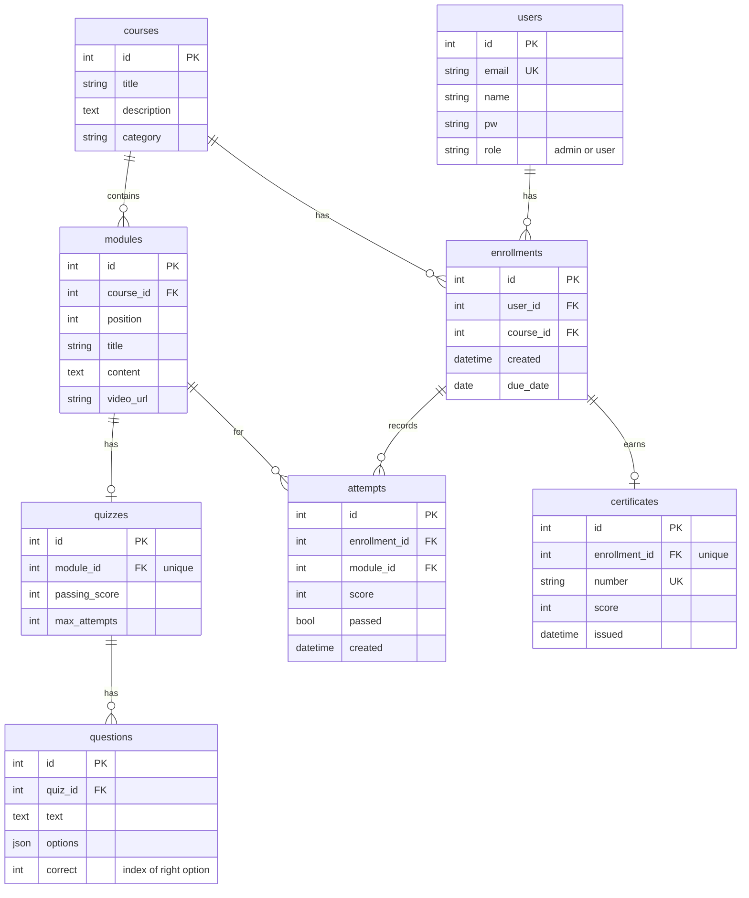

# Training and Certification Platform

A full-stack web app where admins create courses, modules and quizzes, assign them to learners with due dates, and learners complete them module by module to earn a verifiable certificate.

**Stack:** React (Vite) · FastAPI (Python) · SQLAlchemy · PostgreSQL

## Features

**Admin**
- Course, module, quiz and user management (create, edit, delete)
- Dashboard: enrollments, per-module progress, quiz attempts, certified count
- Assign courses to users with an optional due date (email sent on assignment)
- Send deadline reminders to learners who are overdue or due within 3 days

**Learner**
- Course search and category filter
- Self-enroll, then work through modules in order (a module unlocks only after the previous quiz is passed)
- Quizzes with shuffled question order, pass mark, retries and a max-attempts limit
- Certificate on completion: public verifiable web page and PDF download
- Email notifications for assignments, quiz results and certificates (demo mode writes to `backend/emails.log`)
- Email/password login and Google sign-in

## Architecture

```
React (Vite) frontend  --REST/JSON + JWT-->  FastAPI backend  --SQLAlchemy-->  PostgreSQL
```

- **Frontend** (`frontend/`): React single-page app calling the REST API with a bearer token.
- **Backend** (`backend/main.py`): FastAPI app. Routes are thin; business rules live in plain functions so they are easy to test:
  - `grade()` scores a quiz submission
  - `statuses()` computes which modules are done or unlocked
  - `issue_certificate()` checks completion and creates the certificate
- **Auth:** JWT bearer tokens. The first registered user becomes admin; later users are learners. Admin-only routes use an `admin` dependency.
- **Emails** (`backend/notify.py`): sent as FastAPI background tasks so requests are not slowed down. Demo mode appends to `emails.log`.
- **Certificates:** certificate number is a hash of (user, course), so it is deterministic and one per enrollment. The PDF is generated with ReportLab.
- **Database:** PostgreSQL database `training`. Tables are created automatically on startup.

## Database schema



`enrollments` has a unique constraint on (`user_id`, `course_id`). Deleting a course, module, quiz or user cascades to the rows that depend on it.

## Setup

**Prerequisites:** Python 3.10+, Node.js 18+, PostgreSQL 14+

**1. Database**
```sql
CREATE DATABASE training;
```

**2. Backend**
```powershell
python -m venv .venv
.venv\Scripts\activate
pip install -r backend/requirements.txt
cd backend
```
Create `backend/local_settings.py` (git-ignored) with your PostgreSQL password:
```python
DB_PASSWORD = "your-password"
```
Or set the `DATABASE_URL` environment variable instead. Optional environment variables: `JWT_SECRET`, `GOOGLE_CLIENT_ID`.

Start the server:
```powershell
python -m uvicorn main:app --reload
```
API: http://127.0.0.1:8000 · Interactive docs: http://127.0.0.1:8000/docs

**3. Frontend**
```powershell
cd frontend
npm install
npm run dev
```
App: http://localhost:5173

## Demo credentials

The first account registered becomes the admin.

| Role | Email | Password |
|------|-------|----------|
| Admin | _add here_ | _add here_ |
| Learner | _add here_ | _add here_ |

## Known limitations

- Passwords use PBKDF2 with a fixed salt; a per-user salt (or bcrypt/argon2) is the production choice.
- `JWT_SECRET` defaults to a development value; set it in any real deployment.
- No automated tests; the grading and unlock logic is isolated in plain functions to make testing straightforward.

## AI usage

See `AI_USAGE.md` for the tools used, how they were used, and the prompt history.